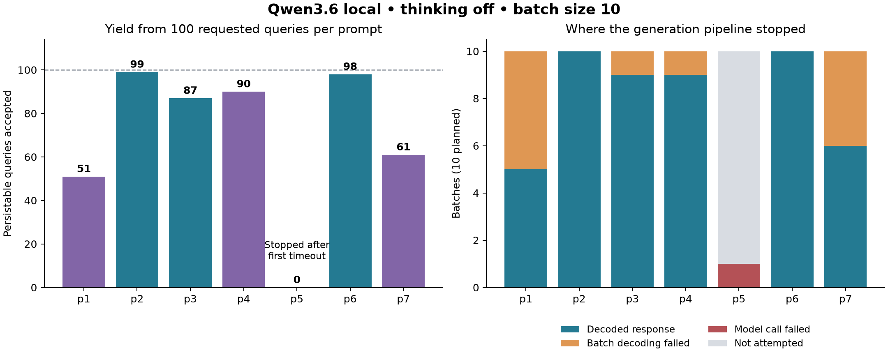
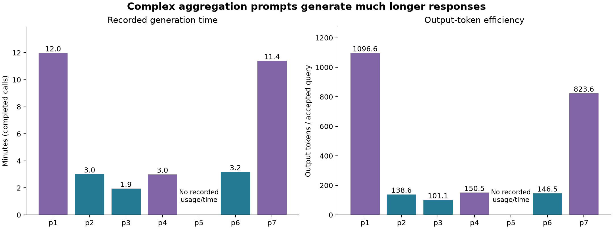

# JSON-Storm: prompt sweep findings

## Complex batches are harder to decode reliably

**Qwen3.6 via Ollama · thinking off · batch size 10**

Seven prompts × 100 requested queries, using the `mathexchange` dataset.

**486 queries accepted across six completed runs.**
One run stopped at its first model timeout.

<!-- Accepted means structurally parsed and persisted, not yet evaluated in MongoDB. -->

---

# Query yield depends strongly on the task



**p2/p6: 98–99 accepted.** Complex aggregations p1/p7: 51–61.

<!-- Teal bars are find prompts; purple bars are aggregation prompts. p5 is incomplete, not a measured 0% validity rate. p1 and p7 each returned 11 entries in one decoded batch. -->

---

# Most losses happen before individual validation

| Failure | Where | Impact |
| :--- | :--- | :--- |
| Malformed JSON / duplicate keys | p1, p4, p7 | 11 entire batches rejected |
| Shell `ObjectId(...)` syntax | p3 | 1 entire batch rejected |
| `skip: null` | p2, p3, p6 | 6 individual queries rejected |
| Model-call timeout | p5 | 1 failed call; 9 batches unattempted |

**One malformed fragment can lose a ten-query batch.**
The 12 rejected batches covered 120 requested query slots.

<!-- Actual query counts inside unreadable batches are unknown. All 60 returned responses reported finish_reason=stop; there was no reported token-limit truncation. -->

---

# Complex output also costs more time and tokens



p1/p7 took **~12 minutes**, versus **~2–3 minutes** for simpler tasks.

<!-- Output tokens per accepted query include discarded responses. p5 lacks recorded call time and usage; missing does not mean zero. Local API cost estimates do not include compute costs. -->

---

# What we can—and cannot—conclude

- **Batch decoding is the main bottleneck** for long aggregation output.
- **Extended JSON is working:** no persistence failures in this sweep.
- Accepted queries still need MongoDB syntax, result-count and timeout checks.
- Each run sampled a **different schema snapshot**; comparison is not fully controlled.
- One run per prompt is exploratory evidence, not a reliable ranking.

**p5 needs a rerun:** its first call exceeded the configured 120-second deadline.

<!-- Exact duplicate counts: p3 five, p4 two, others zero among accepted workloads. These counts say little about semantic diversity. -->

---

# Next: improve yield without hiding failures

1. **Fix the input:** reuse one saved schema/sample snapshot across runs.
2. **Sweep batch size:** 1, 2, 5, 10—especially for p1 and p7.
3. **Recover p5:** test a smaller batch or a separately recorded longer timeout.
4. **Clarify examples:** `skip: 0`, Extended JSON ObjectIds, combined date bounds.
5. **Test structured output separately:** compare JSON mode against the baseline.

Retain raw failures; repeat runs and measure yield, diversity, time and tokens.

<!-- Do not silently repair outputs in the baseline. Vary one factor at a time, or use an explicitly designed factorial experiment. MongoDB evaluation is the next quality check. -->

---

# Evidence and reproducibility

| Prompt | Experiment | Prompt | Experiment |
| :--- | :--- | :--- | :--- |
| p1 | `77f31e59` | p5 | `c1da7a1f` |
| p2 | `072f15a0` | p6 | `cb4bfa15` |
| p3 | `c5c119de` | p7 | `f97b3445` |
| p4 | `0fde4fd3` | | |

[Analysis notes](README.md) · [Summary data](summary.csv) · [Batch data](batches.csv) · [Failure details](failures.json)

Rebuild figures from the repository root:

```sh
uv run python results/prompt-sweep-2026-11-03/analyze.py
```
