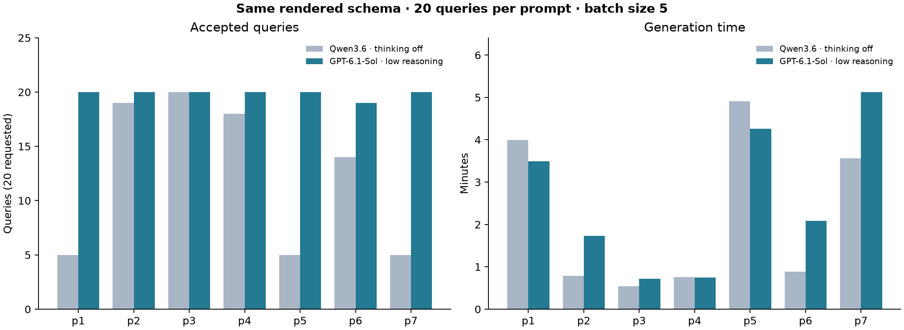
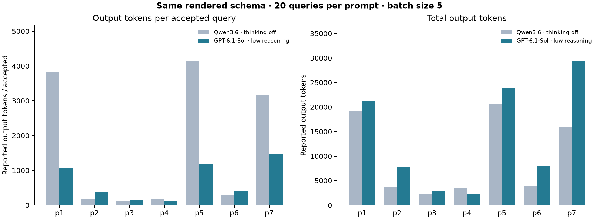

# GPT-6.1-Sol versus Qwen3.6: generation sweep

## Finding

Sol accepted 139/140 requested queries (99.3%), versus Qwen's 86/140 (61.4%): +37.9 percentage points. All 140 Sol queries parsed and satisfied the target constraint; one failed BONDI persistence. There were no batch parsing failures, count mismatches, individual shape errors, target violations or model call failures. All 28 responses ended with stop.

The rendered schema and all corresponding prompt strings match the preceding Qwen sweep exactly. Both request 20 queries per prompt in batches of five, with no examples or relationship hints and target posts. Sol uses chatgpt/gpt-6.1-sol with reasoning_effort=low; Qwen uses ollama_chat/qwen3.6:latest with think=false. This compares complete configurations, including remote subscription versus local inference, not model weights in isolation. One run per prompt does not establish statistical significance.

| Prompt | Sol experiment | Sol accepted | Qwen accepted | Sol distinct fingerprints | Sol seconds | Qwen seconds |
|---|---|---:|---:|---:|---:|---:|
| p1 | 57d6f1c3 | 20 | 5 | 20 | 209.7 | 239.6 |
| p2 | 8e4ea30b | 20 | 19 | 20 | 103.8 | 47.1 |
| p3 | 6654acdc | 20 | 20 | 17 | 42.9 | 32.2 |
| p4 | d78c69d7 | 20 | 18 | 14 | 44.7 | 45.6 |
| p5 | 52a02a82 | 20 | 5 | 20 | 255.7 | 294.3 |
| p6 | af97d240 | 19 | 14 | 19 | 125.1 | 52.8 |
| p7 | 9190cd17 | 20 | 5 | 20 | 307.6 | 213.9 |



## Persistence failure: p6, batch 3, candidate 1 (zero-based)

The response contains a regex inside projection.comments.$elemMatch.text. Extended JSON decoding correctly converts it to bson.Regex. MongoFindQuery.to_json calls `_dump_envelope(envelope, ("filter",))`: only filter receives BSON-aware encoding, leaving a Regex in projection for standard json.dumps, which raises `TypeError: Object of type Regex is not JSON serializable`.

Reproduced from the stored response by parse_batch followed by query.to_json(). Removing the projection on that in-memory diagnostic query makes serialization succeed. No stored artifact or production code was changed. This is a serializer coverage gap, not evidence that the model emitted malformed JSON. MongoDB execution validity remains untested. The original rejected candidate is saved in rejected_candidates.json.

Suggested BONDI fix: round-trip projection through BSON-aware serialization/deserialization, with backwards compatibility and tests for nested BSON values in projections. Merely changing json.dumps to stringify objects would lose types.

## Diversity caveat

Sol has three duplicate entries in p3 and six in p4, measured by native query fingerprints; Qwen had none within each accepted workload. Sol therefore has 130 distinct queries when counted separately within each prompt (92.9% of requested), not necessarily 130 distinct across the whole sweep. p3 has 17 distinct versus Qwen's 20; p4 has 14 versus Qwen's 18. All observed duplicates cross batch boundaries, consistent with independent calls receiving identical prompts without previous-query context; this is not proof of the cause.

Zero-based workload positions sharing fingerprints:
- p3: [0,5], [2,7], [10,15].
- p4: [0,10,15], [1,11,16], [3,18], [4,13].

Fingerprint uniqueness is not semantic diversity. Do not silently deduplicate the measured generation yield; report distinct yield alongside it.

## Runtime and usage

Sol took 18.16 minutes of recorded model-call time versus Qwen's 15.43 (+17.7%), for 61.6% more accepted queries. Average time per accepted query was 7.84 seconds versus 10.76. Sol is not uniformly faster: p2/p6/p7 took longer, p1/p5 less, p4 approximately equal.



Sol reported 40,824 input and 95,206 output tokens (136,030 total). Qwen reported 69,015 output tokens. Sol's output per accepted query was 685 versus Qwen's 803. Different tokenizers and provider accounting limit direct token comparisons; these are not monetary cost estimates. This run uses subscription billing, so per-token API prices do not apply.

Reported reasoning tokens total 117 (p5=37, p6=54, p7=26); reported cached input tokens total 1,280, all in p3. These are usage subcategories, not additional quantities to add to total_tokens. Zero reported reasoning tokens should not be read as proof that reasoning was disabled: the configured effort is low.

## Next steps

1. Fix BSON-aware projection persistence and recover the excluded query from the original raw artifact into a separate derived workload, preserving this run's recorded outcome.
2. Add distinct-query yield as an explicit analysis metric; investigate cross-batch repetition for p3/p4 separately from format compliance.
3. Evaluate accepted workloads against MongoDB to measure syntax/operator errors, runtime, timeouts and empty/nonempty results. Generation acceptance alone does not establish executable or useful queries.
4. Repeat matched sweeps before making general model rankings. Keep reasoning, provider route, schema and prompt settings explicit.

## Reproduction

Run from the repository root:

```sh
uv run --locked python results/prompt-sweep-gpt61sol-2026-11-03/analyze.py
```

The script reads explicit Yanex experiment IDs, native Workload artifacts and the previous sweep summary.csv. It writes summary.csv, batches.csv, comparison.csv, failures.json (batch errors; empty here), rejected_candidates.json and PNG/SVG figures. No generation or MongoDB execution occurs. Serializer diagnosis, prompt equality and duplicate positions were additionally checked against raw artifacts.
