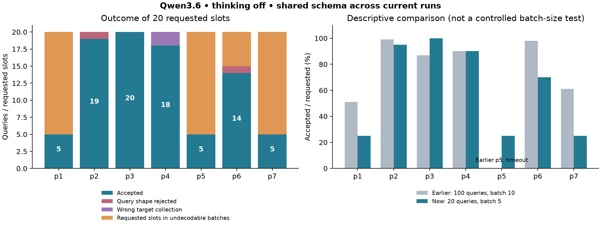
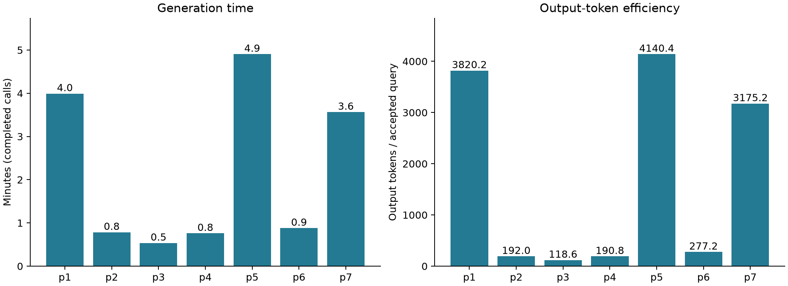

# Second prompt sweep: 20 queries, batch size 5

All seven runs use `ollama_chat/qwen3.6:latest`, `think: false`, timeout 120 seconds, no value examples or relationship hints, target collection `posts`. Each requests four batches of five queries. All depend on schema experiment `a0da1c20`; all rendered schema hashes match (see summary.csv). This removes within-sweep schema variation.

## Results

| Prompt | Experiment | Accepted | Yield | Generation seconds | Output tokens / accepted |
|---|---|---:|---:|---:|---:|
| p1 | 28b9755c | 5 | 25% | 239.6 | 3820 |
| p2 | 669c89c4 | 19 | 95% | 47.1 | 192 |
| p3 | 8adf1c41 | 20 | 100% | 32.2 | 119 |
| p4 | cf3ae5f7 | 18 | 90% | 45.6 | 191 |
| p5 | 5f3c7b72 | 5 | 25% | 294.3 | 4140 |
| p6 | 4ef16c01 | 14 | 70% | 52.8 | 277 |
| p7 | e8999d55 | 5 | 25% | 213.9 | 3175 |

86/140 requested queries accepted (61.4%). Ten undecodable batches account for 50 requested slots; two individual shape errors and two target violations account for the remaining four. Requested slots are not recovered candidate counts: the parser cannot enumerate queries in an undecodable response. All 28 calls returned, all report finish_reason=stop. There are no exact fingerprint duplicates within any accepted workload; that does not establish semantic diversity or cross-prompt uniqueness.



## Failure evidence

Batch indexes below are zero-based. `failures.json` records original errors and surrounding response text.

- **p1**, batches 1–3: malformed brackets in a long expression; a bare `{"$dateNow"}` object without a value; JavaScript `undefined` inside JSON.
- **p5**, batches 0, 1, 3: mismatched nesting; `"else": {-1}` (not a JSON object); malformed object/array construction around `"true", "false"`.
- **p7**, batches 0–2: inline arithmetic `60 * 60 * 24` inside an array; mismatched nesting; unquoted keys such as `$facet` and `$addFields`.
- **p6**, batch 1: duplicate `creationDate` key, rejected deliberately rather than silently overwriting an earlier constraint.
- **p2**, batch 2 candidate 4: `skip: null`, which violates the integer contract. Current error wording says “not a boolean” even for null; the rejection is correct but the message is imprecise.
- **p6**, batch 2 candidate 3: sort field is an object (`{"$meta":"textScore"}`), not a string. This is also outside the currently supported sort contract.
- **p4**, batch 0 candidates 0 and 3: start at `postHistory` and `users`; both parse but violate the requested `posts` starting collection. Cross-collection lookups remain permitted.

This is not primarily an Extended JSON persistence failure. The dominant failures are malformed JSON/JavaScript-like output. `stop` provides no evidence of a reported token-limit cutoff, though it cannot prove the model completed its intended content.

## Efficiency and interpretation



p3 achieves the best observed yield and efficiency. p1/p5/p7 produce long, fragile aggregation responses: roughly 3,175–4,140 output tokens per accepted query, versus 119 for p3. These prompts ask for different query complexity, so this is cost per accepted query, not a quality ranking.

Compared with the first sweep, p1 falls from 51% to 25%, p7 from 61% to 25%, p6 from 98% to 70%; p3 rises from 87% to 100%. p4 remains 90%, but its losses now come from target violations. p5 now completes all calls, whereas its first-sweep run stopped on a timeout. Batch size 5 did not solve the observed formatting problem. This does not establish that smaller batches reduce yield: schemas changed between sweeps, the current sample is only four calls per prompt, and there are no replicated runs. Each failed batch moves yield by 25 percentage points.

Accepted means parsed, target-compliant, and persistable—not validated by MongoDB or known to return documents. These analyses execute no generated queries.

## Suggested next experiments

1. Keep this schema dependency fixed. Tighten shared format examples: omit unused skip, never emit undefined or inline arithmetic, quote every key, combine same-field conditions without duplicate keys, and begin every query at posts. Measure this change separately.
2. Test structured JSON output as a separate treatment, retaining the original raw responses and strict parser. It can address JSON grammar; it does not guarantee legal MongoDB operations or useful queries.
3. Compare batch sizes 1/2/5/10 with equal requested totals, multiple repetitions, and interleaved run order. Keep prompts, schema and model settings fixed; report yield, exact duplicates, tokens and time. Avoid treating queries within a single failed batch as independent observations.
4. Proceed to MongoDB evaluation of accepted workloads. Generation success alone cannot rank execution validity or nonempty-result yield.

## Reproduction

From the repository root:

```sh
uv run --locked python results/prompt-sweep-q20-b5-2026-11-03/analyze.py
```

The script reads explicit Yanex experiment IDs, loads native Workload artifacts, exports summary.csv, batches.csv and failures.json, and rebuilds PNG/SVG figures. It uses the earlier analysis summary.csv for comparison. Batch artifacts are accessed by the flattened filenames actually saved by Yanex. No model requests or MongoDB calls are made. Failure interpretation above was inspected manually against raw responses.
