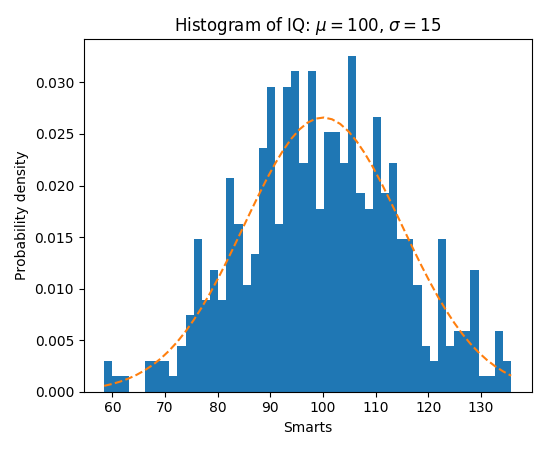

# Your Project
## Progress Update How-To Guide

--- 

# Table of Contents

1. [About this file](#3)
2. [Formatting and code](#4)
3. [Images](#6)
4. [Background images](#7)
5. [Math equations](#9)
6. [Tables](#11)
7. [Slide settings](#12)
8. [Your progress update](#13)

---

# About this file

This is an example of how you can structure your progress updates with your supervisors. 

It is a Markdown file that can be rendered into slides using the [Marp](https://marp.app) tool.

Install the [Marp for VS Code extension](https://marketplace.visualstudio.com/items?itemName=marp-team.marp-vscode), then choose "Markdown: Open Preview" from the command palette, or click the "Open Preview to the slide" icon in the top right corner of the editor.

It supports images, tables, equations and standard Markdown formatting features. 

You can also export your slides to _PDF_, _HTML_ or _PowerPoint_ formats with the "Marp: Export Slide Deck" command. 

---

# Formatting


Use ordinary Markdown for emphasis, lists, links and quotations.

- **Bold** uses `**Bold**`; *italic* uses `*italic*`.
- Inline code such as `index_set` uses backticks.
- [BONDI documentation](https://relaxed-constraints.github.io/bondi/) uses `[text](URL)`.

> Put `>` before a paragraph to make a quotation.

Use `#` for a slide title and `##` for a subheading.
A line containing `---` starts the next slide.

---

# Code blocks

Use three backticks and a language name for syntax highlighting:

````markdown
```python
from bondi.mongodb import MongoCollectionRef

target = MongoCollectionRef("bondi_demo", "electric_vehicles")
print(target.database)
```
````

```python
from bondi.mongodb import MongoCollectionRef

target = MongoCollectionRef("bondi_demo", "electric_vehicles")
print(target.database)
```

---

# Images

```markdown

```


Paths are relative to this Markdown file. Use `w:` or `h:` to resize.
Keep the image alongside the deck when sharing the source.

---


# Background images

This slide uses the same histogram as a faded background.

```markdown

```

- `bg` fills the background; the default `cover` may crop the image.
- `bg contain` fits the whole image without cropping.
- `opacity:0.12` fades the image so the text stays readable.

For results, prefer a foreground image or the split layout next.

---


# Split backgrounds

The image occupies the right half;
text stays on the left.

```markdown

```

Use `left:40%` to place an image
on the left and give text more space.

---

# Inline math

Wrap a formula in single dollar signs:

```markdown
The sample mean is $\bar{x}$ and the standard deviation is $\sigma$.
```

The sample mean is $\bar{x}$ and the standard deviation is $\sigma$.

```markdown
For query times $t_1, \ldots, t_n$, the mean is $\bar{t}$.
```

For query times $t_1, \ldots, t_n$, the mean is $\bar{t}$.

This deck selects `math: mathjax` in its front matter.

---

# Block equations

Use double dollar signs for a centred, standalone equation:

```latex
$$
\text{speedup} = \frac{T_{\text{baseline}}}{T_{\text{candidate}}}
$$
```

$$
\text{speedup} = \frac{T_{\text{baseline}}}{T_{\text{candidate}}}
$$

For example, $600\,\text{ms} / 200\,\text{ms} = 3$:
the candidate is **3 times as fast**. These are illustrative values.

---

# Tables

Use pipes for columns; `---:` right-aligns a numeric column.

```markdown
| Index set | Time (ms) | Speedup |
| :-------- | --------: | ------: |
| Baseline  |       600 |    1.0x |
| Single    |       200 |    3.0x |
```

| Index set | Time (ms) | Speedup |
| :-------- | --------: | ------: |
| Baseline  |       600 |    1.0x |
| Single    |       200 |    3.0x |

**Illustrative values only**, not measured BONDI results.

---

<!-- _backgroundColor: "#eef5ff" -->

# Slide settings

The YAML at the top sets the theme, page numbers and footer.
The footer links back to slide 2, the table of contents.

To change just this slide, add an underscore-prefixed directive:

```markdown
<!-- _backgroundColor: "#eef5ff" -->
```

Without `_`, local settings also apply to following slides.
`theme` applies to the whole deck: try `default`, `gaia` or `uncover`.

The `#2`, `#3`, … links use slide numbers; update them if you reorder slides.

---

# Your progress update

Replace the examples with a short account of your own work:

1. **Question:** What were you trying to achieve?
2. **Progress:** What did you complete since the last meeting?
3. **Results:** Show charts or tables to explain your findings.
4. **Blockers:** What is unclear, and what feedback do you need?
5. **Next steps:** What will you do before the next meeting?

Keep each slide focused. Duplicate this file for the next update.

<!-- Presenter note: Ask which next experiment would be most informative. -->

---

# Syntax references

- [Marp: overview and example slides](https://marp.app/)
- [Slide separators](https://marpit.marp.app/markdown)
- [Directives: themes, colours, headers and footers](https://marpit.marp.app/directives)
- [Images: sizing, backgrounds and split layouts](https://marpit.marp.app/image-syntax)
- [Math and Markdown extensions (Marp Core v4)](https://github.com/marp-team/marp-core/tree/v4#math-typesetting)
- [Marp for VS Code](https://github.com/marp-team/marp-vscode)

Preview while editing to check that content fits each slide.
Export HTML for presenting in a browser, or PDF for sharing.
